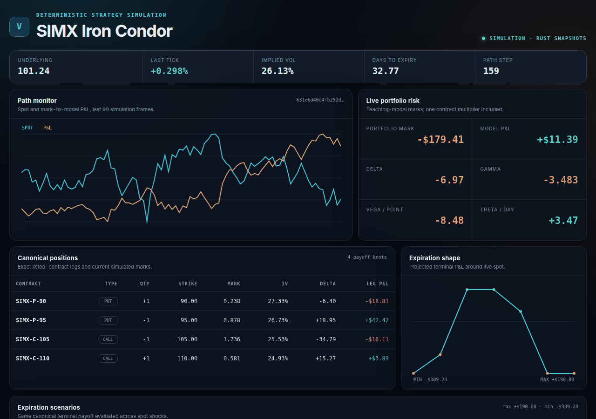
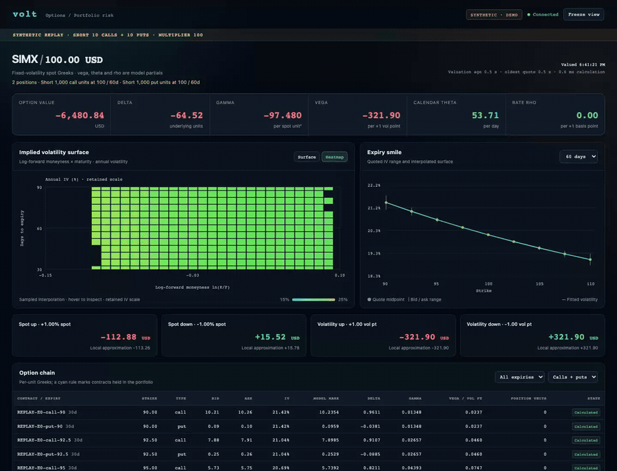
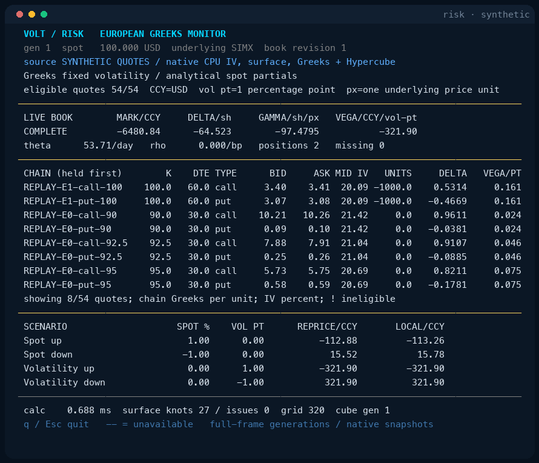

# Volt

Typed, canonical options portfolio logic with deterministic lifecycle,
simulation, and payoff analysis.

Volt is a typed, composable representation and runtime for options
portfolios. A portfolio is simultaneously a set of listed contracts, a payoff
shape, a collection of path risks, and a state that evolves through exercise,
assignment, expiry, and trading. Volt keeps those meanings together in one
canonical model.

Volt is part of the open-source analytical architecture behind strategynet.ai.
Read the
[Volt architecture overview](https://strategynet.ai/insights/volt-open-source-options-portfolio-logic).

The publishable Cargo package is named `volt-options`; its Rust library name
remains `volt`.

The initial Rust release provides:

- typed call and put contracts with European, Bermudan, and American exercise;
- cash and physical settlement;
- exact portfolio canonicalization and stable semantic hashes;
- terminal payoff projections without conflating them with dynamic equivalence;
- deterministic exercise, assignment, expiry, and replay journals;
- path simulation with explicit fill and transaction-cost models;
- a point-in-time candidate grammar for strategy discovery;
- a versioned structured COG compiler with diagnostics and immutable artifacts;
- versioned graph samples for optimization and learning systems; and
- generated and historical market observations behind one trait.

Volt is a financial-logic library. It does not contain brokerage connectivity,
live data vendors, account policy, or order-submission authority.

For the fuller story, read:

- [How Volt fits together](https://github.com/ingvor-restrat/volt/blob/main/docs/architecture.md)
- [Programs and naming](https://github.com/ingvor-restrat/volt/blob/main/docs/programs.md)
- [COG compiler](https://github.com/ingvor-restrat/volt/blob/main/docs/cog-compiler.md)
- [Supervised graph learning](https://github.com/ingvor-restrat/volt/blob/main/docs/supervised-gnn.md)
- [`risk` live walkthrough](https://github.com/ingvor-restrat/volt/blob/main/docs/markup/README.md)
- [Reproducible results](https://github.com/ingvor-restrat/volt/blob/main/docs/results.md)
- [Long-form LaTeX papers](https://github.com/ingvor-restrat/volt/blob/main/docs/latex/README.md)

## Quick start

```bash
cargo test
cargo run --example risk
cargo run --example risk_server
cargo run --example zap
cargo run --example cog -- --output /tmp/volt-cog.json
cargo run --example graph -- --output /tmp/volt-graphs.jsonl
cargo run --bin graph_export -- --input request.json --output graphs.json
cargo run --bin scenario_batch -- --input scenarios.json --output results.json
```

`risk` is the compact, `top`-like terminal monitor. `risk_server` serves the
same Rust simulation as an aligned browser dashboard at
[http://127.0.0.1:8081](http://127.0.0.1:8081). Both run a canonical four-leg
*iron condor* through a correlated spot/volatility path and display live marks,
Greeks, expiration P&L, and a spot/volatility shock grid. The pricer is an
educational adapter; Volt remains the authority for exact contracts,
canonicalization, and payoff algebra.

[](docs/markup/README.md)

The Options Risk application follows observed quotes and paired stock prices
through implied volatility, exercise-aware Greeks and portfolio exposures. The
historical demonstration covers 64 American contracts across eight stocks and
ETFs, with an illustrative position book and explicit carry assumptions.
[Watch the browser and terminal recordings](https://strategynet.ai/research/options).

[](https://strategynet.ai/research/options)

<details>
<summary>European synthetic examples</summary>

The European quote-to-Greeks example adds fitted volatility, portfolio Greeks
and fully repriced scenarios. Its browser and `top`-style terminal viewer consume
the same native snapshot format.
[View recordings and run commands](demo/live-greeks.html), or follow the
[demo guide](docs/markup/README.md#european-quote-to-greeks-viewer).

[](demo/live-greeks.html)

[](demo/live-greeks.html)

</details>

American and Bermudan requests use the [exercise-aware pricing API](docs/exercise-pricing.md),
including dated exercise, dividends, implied volatility and Greeks. The
[HTTP worker and terminal viewer](docs/exercise-risk-service.md) connect these
calculations to dated quotes and stock observations. The
[incremental Hypercube service](docs/exercise-publication.md) recalculates the affected
underlying and publishes a combined view with explicit calculation ages. See the
[research collection](https://strategynet.ai/research/options) for actual historical
American-option recordings and the application papers. Raw replay data stays
outside this source checkout.

[Factor scenarios](docs/factor-scenarios.md) connect covariance, return forecasts and
option liabilities to separate hedge-only, signal-only and combined policy tasks.
[Financial lot allocation](docs/financial-lot-qubo.md) supplies a quadratic
Greek-risk objective and an exact discrete baseline with fees and position limits.

`zap` shows how exact portfolio canonicalization and terminal-payoff projection
reduce a small option search space. `cog` compiles structured options-design
business logic into an immutable artifact, produces a point-in-time legal
action mask and state/action graph, and journals a runtime transition. `graph`
emits deterministic JSON Lines fixtures built from synthetic marks and scenario
weights.

`graph_export` is the data-independent bridge used by research applications.
It validates declared contracts and marks, canonicalizes each quantity vector,
and returns portfolio hashes, terminal-payoff hashes, and graph samples.
`scenario_batch` evaluates complete paths and scheduled actions through the
scenario simulator, returning fills, pathwise P&L, runtime journals, final
states, and result hashes.

An optional reference training harness consumes the exact graph export and
learns a relation-aware portfolio embedding:

```bash
python3 -m venv .venv
.venv/bin/python -m pip install -r requirements-ml.txt
PYTHON=.venv/bin/python scripts/run_supervised_demo.sh
```

It reports held-out performance against mean and linear pooled-feature
baselines and retains the exact portfolio/payoff hashes with every embedding.
See [Supervised graph learning](docs/supervised-gnn.md) for the semantic
boundary, evaluation policy, and route to reinforcement learning.

## Optional Rust compute

The [Volt Compute companion package](crates/volt-compute/README.md) provides native
CPU, Metal, and CUDA numerical execution, memory admission, matrix operations,
European option valuation, and a validated portfolio/market adapter. It builds
with the repository's pinned Rust 1.99.1 toolchain in a shared Cargo workspace
and leaves the core package dependencies unchanged. It also provides
Black–Scholes AAD Greeks and spot gamma, GBM Monte Carlo risk, Heston Fourier risk, time-stepped markets, native Deep Hedging
training/checkpoint/resume, and exact integer hedge reconciliation. Matched
benchmarks compare learned, genuine model and no-hedge strategies on identical
held-out paths. Heston path integration is a declared approximation; paper
replication has not been established. The companion README documents commands,
assumptions and the adaptive CPU-f64 Heston baseline.

See [training on a compute host](docs/compute-training.md) for checkout, CPU/CUDA
builds, background training, resume and held-out evaluation.

The [practical primer](docs/latex/compute/volt_option_learning_primer.pdf) develops
the financial and mathematical background, with worked examples and a reading guide.
The [Bermudan application](docs/bermudan-market.md) adds numerical holder rules,
dated settlement, dividends and complete writer training. The
[learned-stopping guide](crates/volt-compute/docs-deep-stopping.md) develops the
2019 direct exercise objective, 2020 continuation regression, valuation bounds
and interval hedging. Run the complete synthetic writer workflow with
`python3 examples/bermudan_learning.py --output /tmp/volt-bermudan-example`
after building the `bermudan_market` and `native_learner` release binaries.

Run `cargo test --release --locked --workspace` to test both crates. Plain
`cargo test` selects the core; GPU support is enabled explicitly in `volt-compute`.

## Core model

```rust
use volt::{
    CanonicalPortfolio, ExerciseSchedule, OptionContract, OptionRight, Position,
    PriceMicros, Settlement, TimestampNs,
};

let expiry = TimestampNs(1_800_000_000_000_000_000);
let call = OptionContract::new(
    "XYZ-C-100",
    "XYZ",
    "USD",
    OptionRight::Call,
    PriceMicros(100_000_000),
    100,
    ExerciseSchedule::European { expiry },
    Settlement::Physical,
)?;
let portfolio = CanonicalPortfolio::from_positions(vec![Position::new(call, 1)?])?;
let payoff = portfolio.terminal_payoff_projection()?;

# Ok::<(), volt::VoltError>(())
```

All money values use integer micro-units. Timestamps use integer nanoseconds.
Serialized structures carry explicit schema versions, and semantic hashes are
computed from canonical serialized forms.

## Extraction boundary

This repository contains the reusable options-logic engine, its derivative
examples, and a small synthetic reference training harness. Application-
specific data archives, production cohort builders, trained policies, services,
and execution adapters remain outside Volt.

Licensed under Apache-2.0.

## Numerical application papers

The [computation and hedging papers](docs/latex/compute/README.md) explain pricing,
Greeks, hedge learning, live option analytics and straddle experiments, with
[canonical LaTeX sources and PDFs](docs/latex/compute/).
