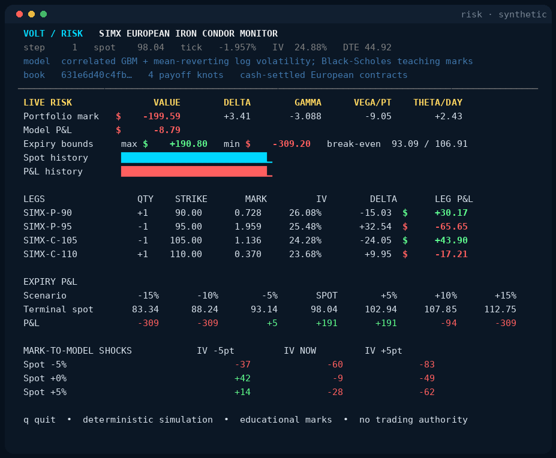

# `risk`: the Volt terminal demo



`risk` is a practical hello world for the public options model:

```bash
cargo run --example risk
```

It constructs a cash-settled European *iron condor* on a fake index:

```text
+1 SIMX 90 put
-1 SIMX 95 put
-1 SIMX 105 call
+1 SIMX 110 call
```

Volt validates the four exact contracts, canonicalizes their signed
positions, hashes the portfolio, and derives its terminal hinge payoff. The
example then advances a correlated spot/volatility simulation and refreshes:

- each leg's theoretical mark, implied volatility, delta, and P&L;
- portfolio delta, gamma, vega, theta, and mark-to-model P&L;
- expiration P&L across spot shocks; and
- a live spot-by-volatility shock grid.

The spot process is geometric Brownian motion with log volatility following a
mean-reverting process and a negative spot/volatility correlation. The
Black–Scholes marks are an educational adapter in the example—not a claim that
Volt supplies a production pricing model or market quote.

Press `q` or Escape to quit. A bounded, ANSI-free run is useful in logs:

```bash
cargo run -q --example risk -- --ticks 1 --no-color
```

This division is visible in the code:

```text
Volt:      exact contracts -> canonical portfolio -> terminal payoff
example:   synthetic path  -> teaching marks      -> live risk display
```

## Rebuild the recording

The committed GIF comes from deterministic frames emitted by `risk`:

```bash
python3 docs/markup/record.py
```

The recorder needs Python and Pillow. It uses a fixed seed and invokes the real
example, so the animation is reproducible rather than a hand-built mockup.
