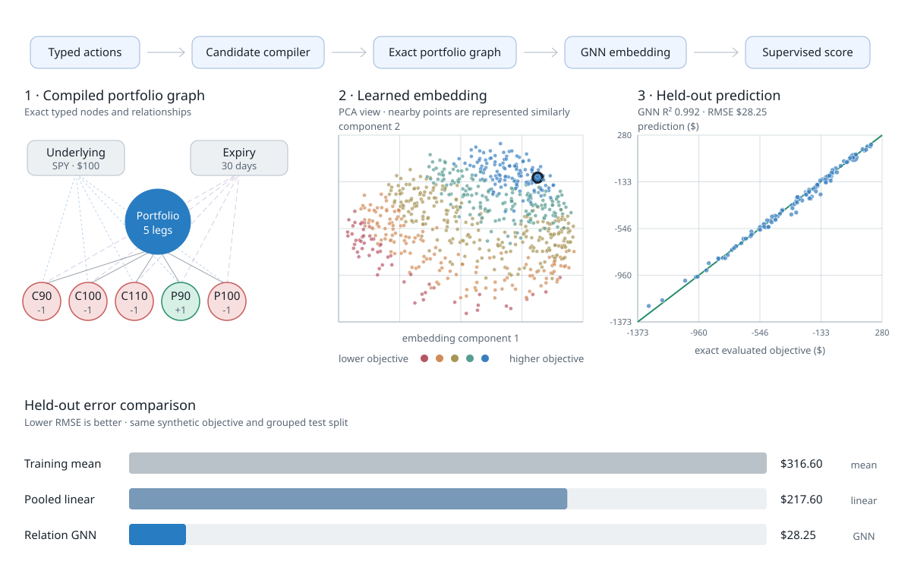

# Volt live risk displays

The browser and terminal presentations use Rust-produced risk snapshots from
deterministic synthetic markets. Each pair shares its own snapshot format,
with pricing and portfolio calculations supplied by Rust.

## European quote-to-Greeks viewer

The new browser and `top`-style terminal viewer present actual results from
Volt's European pricing and Greeks service. The recordings use synthetic
stock marks and option quotes, with two signed positions: short ten calls and
ten puts at strike 100, each with multiplier 100. Their negative gamma and
vega and positive calendar theta describe this short-straddle book.

[Open the two-viewer overview](../../demo/live-greeks.html).


The browser follows Volt's dark cyan/amber display style, with aligned numeric
metrics, a labelled IV heatmap, a two-direction surface mesh and an expiry
smile. The annual-IV colour and height scale is retained across updates and
expands when a new observation requires it. Spot and volatility scenarios use
full repricing alongside their local Greek approximation.

Start the local service, then open <http://127.0.0.1:8088>:

```bash
cargo run --release --locked -p volt-compute --features live-risk \
  --bin live_option_risk -- --address 127.0.0.1:8088
```

The default producer supplies deterministic synthetic European quotes.
The service calculates IV, bounded total-variance interpolation, per-unit
Greeks and signed option-book exposures. The browser receives complete
results over HTTP/SSE. Freeze/resume, expiry and call/put filters, surface
rotation and contract selection preserve their financial units.


In another terminal:

```bash
cargo run --example live_risk_top -- --address 127.0.0.1:8088
```

A bounded plain-text view is useful in logs:

```bash
cargo run --example live_risk_top -- \
  --address 127.0.0.1:8088 --ticks 1 --no-color
```

The terminal consumes the native service snapshot format and formats its
prices, Greeks, signed positions and scenarios. Recorded playback can also
read saved snapshot JSONL with `--input snapshots.jsonl --record --ticks 64`.
The contract multiplier is already included in displayed signed option
units. Chain Greeks describe one option per underlying unit; portfolio
totals apply the signed units once.

This application covers European exercise under its declared carry and
surface conventions. American and Bermudan pricing require exercise-aware
valuation engines. The supplied markets are synthetic teaching data.

## Supervised graph learning



The diagram uses the verified 729-sample synthetic experiment. It connects the
typed candidate compiler to one exact portfolio graph, projects every learned
64-dimensional embedding into two dimensions, plots held-out predictions
against the Rust evaluator, and compares test RMSE with the two baselines.

[Open the interactive graph-learning view](gnn-learning.html), where selecting
or clicking a portfolio updates its exact graph, embedding position, and
prediction together.

## Browser dashboard


Run the local server and open
[http://127.0.0.1:8081](http://127.0.0.1:8081):

```bash
cargo run --example risk_server
```

The browser uses semantic tables, tabular numerals, and bounded chart panels
so changing values remain aligned. Snapshots stream from Rust over
Server-Sent Events.

## Terminal monitor


`risk` keeps the compact, keyboard-friendly feel of `top`:

```bash
cargo run --example risk
```

It constructs a cash-settled European *iron condor* on a fake index:

```text
+1 SIMX 90 put
-1 SIMX 95 put
-1 SIMX 105 call
+1 SIMX 110 call
```

Volt validates the four exact contracts, canonicalizes their signed
positions, hashes the portfolio, and derives its terminal hinge payoff. The
example then advances a correlated spot/volatility simulation and refreshes:

- each leg's theoretical mark, implied volatility, delta, and P&L;
- portfolio delta, gamma, vega, theta, and mark-to-model P&L;
- expiration P&L across spot shocks; and
- a live spot-by-volatility shock grid.

The spot process is geometric Brownian motion with log volatility following a
mean-reverting process and a negative spot/volatility correlation. The
Black–Scholes marks are an educational adapter in the example—not a claim that
Volt supplies a production pricing model or market quote.

Press `q` or Escape to quit. A bounded, ANSI-free run is useful in logs:

```bash
cargo run -q --example risk -- --ticks 1 --no-color
```

This division is visible in the code:

```text
Volt:      exact contracts -> canonical portfolio -> terminal payoff
example:   synthetic path  -> teaching marks      -> live risk display
```

## Rebuild the recordings

The original iron-condor recording `risk.gif` comes from deterministic frames
emitted by `risk`:

```bash
python3 docs/markup/record.py
```

The original browser recording `risk-web.gif` comes from its local simulation
server and headless Chrome:

```bash
python3 docs/markup/record_web.py
```

The graph-learning SVG is rebuilt from the generated experiment artifacts:

```bash
.venv/bin/python docs/markup/render_gnn.py
```

The recorders need Python and Pillow; the browser recorder also needs Chrome
and `websocket-client`. Both use a fixed seed and invoke the real examples, so
the animations are reproducible rather than hand-built mockups.

### Rebuild the native Greeks recordings

The capture tools use synthetic quotes and the actual native service. Python's
standard library runs the replay and independent Greek/scenario controls. Browser
recording additionally uses Node with Playwright/Chromium; terminal rendering uses
Python with Pillow and FFmpeg. Use a capture environment with those tools available.
`VOLT_PLAYWRIGHT_MODULE` can name an installed Playwright module when it is outside
Node's normal module path.

```bash
cargo build --release -p volt-compute --features live-risk --bin live_option_risk
cargo build --example live_risk_top
python3 docs/markup/replay_live_greeks.py \
  --output target/live-greeks-capture --record
python3 docs/markup/record_live_greeks_top.py \
  --snapshots target/live-greeks-capture/snapshots.jsonl \
  --output target/live-greeks-terminal
```

Each capture uses a fresh output directory. The producer advances quote timestamps
and remaining maturity at the configured replay interval. Saved native snapshots
allow deterministic terminal playback; `--duration-ms` controls its presentation
pacing. The browser capture emits WebM, screenshots and quality checks. The terminal
capture emits GIF and MP4 plus the actual ANSI frames. `--font` and `--bold-font`
select terminal fonts when Menlo or DejaVu Sans Mono is unavailable.

The replay independently checks prices and deltas, five Greeks through central
price bumps, all signed portfolio sums, and complete spot/volatility scenarios.
The public examples accept the complete JSON frame or native snapshot, so callers
can supply another supported European book.
